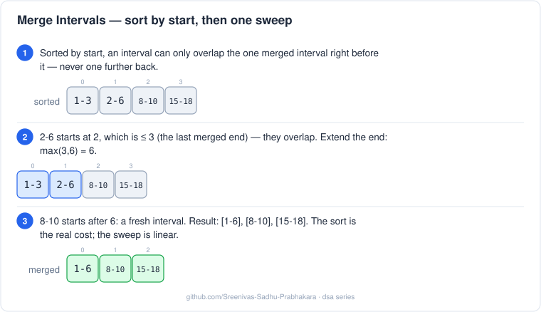

# Merge Overlapping Intervals

> Striver SDE Sheet 008 · Day 2 Arrays — sort by start, then sweep once, extending or appending. Go, stdlib only, tested.

## Problem

Given a list of [start, end] intervals in any order, merge every group of overlapping intervals into one and return the non-overlapping result.

## Approach

Once sorted by start, an interval can only overlap the merged interval immediately before it — never one further back, because starts are non-decreasing. So sort, then sweep: if the current interval starts at or before the last merged end, extend that end (max of the two); otherwise it begins a fresh interval. The sort is the real cost; the sweep is linear.

**Complexity:** O(n log n) time for the sort, O(n) for the output.

## Visual walkthrough

Read the picture top to bottom — each numbered frame is one moment of the algorithm
running on this repo's test example.

## Run

    go test ./...   # verify
    go run .        # demo

---

One of 191 repos solving Striver's SDE Sheet in Go — stdlib only, one problem per repo, every solution tested. Browse the set: [`dsa-*` repos](https://github.com/Sreenivas-Sadhu-Prabhakara?tab=repositories&q=dsa-&type=source).
